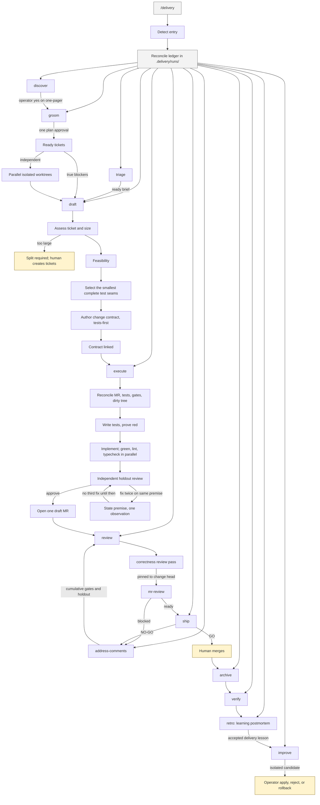

# Delivery

A portable software-delivery skill pack for any LLM or agent runtime that can
load skills and satisfy a small capability contract. The workflow and safety
rules are runtime-independent; native commands, hooks, models, forges, trackers,
and spec tools are optional adapters or providers.

This pack does not run in a text-only chat. Deterministic gates need subprocess
execution. Mutating stages need an enforceable mutation boundary. Forge,
tracker, and review publication run only when those providers are present.

The pack includes:

- `/delivery` — thin conductor, ledger, auto, retro, approval-gated improvement
- `/groom` `/draft` `/execute` `/address-comments` — portable factory stages
- `/code-review-max` `/mr-review` — dual-pass change review
- a bundled OpenSpec archive stage, which requires the OpenSpec CLI

## Install

```bash
git clone https://gitlab.com/Sheikh.Ahmed1/delivery-skills.git
cd delivery-skills
./install.sh --skills-dir .agents/skills
# ./install.sh --skills-dir /path/to/skills --adapter <name>
# ./install.sh --skills-dir /path/to/skills --provider <name>
```

`--skills-dir` is required. The installer never infers a host. Optional
`--adapter <name>` applies setup from `adapters/<name>/` after the generic pack
is in place. Optional `--provider <name>` selects a forge, tracker, or spec-tool
provider from `providers/<name>/`. Generic install includes none of those unless
selected. Named-host wrappers live with those adapters, not in the generic
interface.

What the installer does:

- Runs `bun install --frozen-lockfile` in `factory/`, so every machine uses the
  same pinned dependencies.
- Copies each skill and the runtime into the destination, writing a managed
  manifest. Reinstalls replace only managed files.
- Installs the generic runtime beside the skills at `_factory/`, including its
  pinned runtime dependencies but excluding review scratch files.
- Leaves unmanaged files and delivery state (`runs`, `candidates`, `versions`)
  untouched.
- Fails without replacing an existing install when the destination cannot be
  written.

Reload the host session so the installed skills are picked up.

## Quick start

1. Install the generic pack into a skills directory your runtime loads.
2. Configure a version-1 runtime manifest. This minimal example supports
   read-only work only; continuous delivery additionally needs the capabilities
   listed below. Invocation values are opaque references interpreted by the
   runtime or selected adapter:

   ```json
   {
     "version": 1,
     "capabilities": {
       "process.run": {
         "available": true,
         "mode": "native",
         "invocation": "subprocess"
       },
       "mutation.guard": {
         "available": false,
         "mode": "unavailable",
         "enforcement": "unknown"
       }
     }
   }
   ```

3. In a target repository, invoke the `delivery` skill with `help` or `status`.
   If the runtime exposes slash skills, the equivalent forms are `/delivery
   help` and `/delivery status`.

Read-only stages can run with a smaller capability set. Mutating stages require
`mutation.guard` with `enforcement: "enforced"`. A missing capability produces a
configuration remedy instead of a guessed fallback.

### Capability prerequisites

A host can run this pack when it can:

- Load skills from the installed directory.
- Read and write the target repository, including `.delivery/` and `.review/`.
- Run subprocesses for deterministic gates (tests, verdicts, ledgers).
- Enforce a mutation boundary before any mutating stage. Without that, read-only
  stages still run and mutating stages stop closed.
- Dispatch isolated mutating agents with an explicit working directory and
  environment. This is required to run independent tickets concurrently.
- Provide forge, tracker, or review-publish capabilities when a stage needs
  them. Continuous groom needs tracker create and link support after plan
  approval. Missing providers stop at that boundary and keep completed
  artifacts.

Portability means any host that satisfies those capabilities. It does not mean
the pack invents tools a host does not expose.

## Use

In the target repository:

```text
/delivery <idea, PRD path, or epic key>
/delivery auto <existing run key>
/delivery help
```

`/delivery` invokes the stage skills through delivery descriptors. Slash names
are packaging sugar for hosts that load skills that way.

## Continuous delivery

Use `/delivery <idea-or-PRD>` for new work or `/delivery auto <key>` to resume
existing work. The skill grills the product decisions and presents the final
atomic ticket plan. Your approval of that plan is the single routine delivery
authorization for the run.

After approval, it automatically:

1. Creates or reuses exactly the approved tracker tickets and dependency links.
2. Finds every ticket whose real blockers are already merged.
3. Starts independent tickets concurrently, one isolated git worktree and
   worker per ticket. True blockers remain ordered.
4. Drafts the change contract, selects test seams, builds test-first, runs all
   gates, performs both review passes, publishes review notes, and prepares each
   merge request for human review.
5. After you merge, archives the change, verifies the deployment, writes the
   engineering retro, and prepares any evidence-backed delivery-skill
   improvement candidate.

It does not ask whether to proceed between those stages. It stops only when:

- a product decision is still needed before the final plan;
- a gate fails or evidence is missing or contradictory;
- a release requires explicit risk acceptance;
- a merge is ready for a human;
- an evaluated skill candidate is ready for exact install or rollback approval.

Plan approval never authorizes merge, tracker status transitions, release-risk
acceptance, bypassing a gate, or installing a skill candidate.

That same approval freezes a hashed run contract at
`.delivery/runs/<id>.run-contract.json`. Later stages check the hash. A ticket,
goal, or write outside that contract is a terminal stop until the operator
approves a new plan version.

Parallel workers never race to edit the shared run ledger. Each writes a
key-specific journal; the coordinator validates those journals against git and
the forge, then records the completed wave in one compare-and-swap update. If
the runtime cannot provide isolated mutating workers, delivery stops with
runnable fan-out commands rather than silently processing independent tickets
sequentially.

## Constitution and run contracts

[`skills/delivery/SDLC-CONSTITUTION.md`](skills/delivery/SDLC-CONSTITUTION.md)
is the short policy kernel for the whole lifecycle. Its machine-readable
companion,
[`sdlc-constitution.json`](skills/delivery/sdlc-constitution.json), maps each
commandment to a schema, gate, state-machine transition, contract test, or
explicit judgement boundary. Every stage loads the same version.

The constitution has highest precedence. The remaining order is the delivery
conductor, auto workflow, ledger contract, current stage spec, and stage skill.
Historical workflow notes are non-actionable. A lower-precedence instruction
cannot enlarge approved scope, claim a human-owned action, or override a
failed deterministic gate.

The kernel requires delivery to:

- stay inside approved scope and prefer the smallest complete vertical change;
- avoid speculative abstractions and adjacent cleanup;
- discover facts before asking for genuine product decisions;
- keep acceptance criteria and tests independent of implementation;
- run every mutation through an enforceable, attributable boundary;
- fail closed on missing, malformed, stale, or ambiguous evidence;
- run independent work concurrently and order only real dependencies;
- preserve security, validation, accessibility, recovery, and data protection;
- resume from durable artifacts rather than conversational memory; and
- record deviations with the affected invariant and a new approval.

Humans always own merge, tracker status, release-risk acceptance, failed-gate
override, and every live-skill install or rollback.

### Frozen scope

When the final groomed plan is approved, delivery writes
`.delivery/runs/<id>.run-contract.json`. It hashes the constitution plus the
approved goal, scope, non-goals, tickets, dependency graph, acceptance
criteria, permitted writes, approval evidence, and human-owned boundaries.
Draft, execute, review, and later stages verify that hash before acting.

A constitution mismatch, changed contract body, unknown ticket, or unapproved
write stops the run. To change scope, create a new plan version that names the
previous contract hash, explains the reason and affected invariant, and records
a new explicit approval. The previous contract remains durable evidence.

Runtime and CI checks use one command:

```bash
bun "$FACTORY_ROOT/scripts/sdlc-constitution.ts" preflight
```

The same helper exposes `freeze`, `check`, and `report` for run-contract
creation, stage-boundary validation, and conformance evidence. See the
constitution itself for the canonical commandments; the README deliberately
does not maintain a second numbered rule catalogue.

## SDLC

`/delivery` is the only command to remember. It routes into the stage skills
below, records state in the target repository's `.delivery/runs/`, and stops for
operator-owned decisions. Approval of the final groomed plan authorizes routine
progression through delivery. Humans still own merge, tracker status, explicit
risk acceptance, and any live-skill install.



Human-owned stops, in order:

1. Product decisions while shaping the work, then one final groomed-plan
   approval.
2. Merge, or explicit acceptance of a release risk.
3. Installing or rolling back an exact delivery-skill candidate.

## Guarantees

Every gate fails closed. A malformed verdict, a missing artifact, or an
ambiguous match stops the run instead of guessing.

- **Tickets are atomic.** Each ticket is one vertical outcome with one to three
  Given/When/Then acceptance criteria, small enough for one fresh session.
  Oversized tickets stop at draft with a proposed split.
- **Independent tickets run concurrently.** Auto reserves each ready wave,
  starts one isolated worktree worker per ticket, and lets the coordinator
  serialize validated journal results into the shared ledger. It never silently
  falls back to sequential execution.
- **Tests come first.** The red gate runs a JSON argv command (never a shell
  string), requires exit code 1, and requires the output to name every new test
  file. A missing command, a timeout, or zero tests is not a red result.
- **Approval needs every dimension.** The holdout review approves only when the
  change is faithful to the spec, the tests are meaningful, the code matches the
  spec, and it is ready for main.
- **Execute opens a draft change request.** It is marked ready only after both
  review passes. Release readiness refuses a draft change or a missing review
  verdict; an operator cannot stand in for a review.
- **Comments are handled once.** Every in-scope comment must be classified,
  with no missing, extra, or duplicate ids. Only replies from the factory's own
  account mark a thread handled, and a human follow-up brings it back into scope.
  If a run stops after replying, the next run still performs the holdout review.
- **Published notes are jailed.** The review publisher posts only files under
  the target repository's `.review/` directory and refuses symlink escapes and
  secret-like filenames.
- **Run state is shared safely.** Ledgers use a generation number and refuse a
  stale write instead of overwriting another session's update.
- **Waiting never polls.** A running pipeline or deploy ends the turn with the
  command to resume.
- **Model routing reads the runtime, then the catalogue.** Each run records the
  exact model identifiers the current runtime advertises into
  `.delivery/routing/model-inventory.json`. The workflow still names the
  required capability (standard or frontier). The catalogue then picks an
  exact advertised identifier for that capability. A cheaper shadow
  recommendation is recorded, never dispatched. Each recorded task captures
  wall time automatically, overlays host token and cost figures when the
  runtime writes them, and otherwise stores character counts of named
  artifacts. After each task, the run scorecard refreshes with actual gate,
  repair, escalation, time, cost, and usage totals. It labels shadow quality
  and savings as unevaluated until a paired benchmark has actually run.
  The paired-evidence generator hashes fixed inputs and managed trees, reads
  captured usage and gate results, and measures output size instead of relying
  on hand-transcribed benchmark evidence. Fast catalogue models stay
  evaluation-only until representative-run scores for that exact candidate
  clear the 90 percent bar with at least five reversible cases and no critical
  misses. Live evidence is not mixed into that sample. Safety floors keep auth,
  migration, concurrency, distributed-state, weak-verification, holdout review,
  and irreversible work on the frontier recommendation. Live availability stays
  unchanged without an exact operator promotion approval naming the candidate.
  Public rankings and unscored fixtures never promote.
- **Retro teaches the engineering journey.** It writes a chronological
  postmortem covering the problem, attempted models, counterexamples, design
  evolution, final invariants, DSA complexity, and system-design trade-offs. It
  does not invent algorithmic depth when the change had none.

## Artifacts

All live state belongs to the target repository and is gitignored:

| Path | Holds |
|------|-------|
| `.delivery/runs/` | Run ledgers, frozen run contracts, discovery evidence, and engineering postmortems |
| `.delivery/workers/<run>/<key>.md` | Isolated worker journals reconciled by the coordinator after a parallel wave |
| `.delivery/routing/` | Advertised model inventory, task profiles, shadow decisions, outcomes, usage capture, per-run scorecards, comparison report, evaluation corpus |
| `.delivery/candidates/`, `.delivery/versions/` | Improvement candidates, generated paired evidence, and rollback copies |
| `.review/<change>/` | Gate commands, append-only gate results, diffs, verdicts |
| `.review/<change-id>/<head-sha>/` | Review brief, max-pass findings, and draft notes |

Review artifacts are keyed by the reviewed head, so `/mr-review` can run in a
fresh session after `/code-review-max`. A new head always needs a new max pass.

## Layout

```text
skills/                    # generic skills any capable host can load
skills/delivery/SDLC-CONSTITUTION.md  # policy kernel loaded by every stage
factory/                   # gate scripts and subagent prompts
factory/model-catalogue.json  # capability tiers to exact advertised models
adapters/                  # optional runtime integrations and compatibility
providers/                 # optional forge, tracker, review, and spec tools
```

Self-improvement (`/delivery improve`) edits `skills/delivery` only, after
approval. Factory changes are ordinary commits in this repository.

## Tests

```bash
cd factory
bun install --frozen-lockfile
bun run check
bun test
cd ..
BUN_RUNTIME_TRANSPILER_CACHE_PATH=0 bun test skills/delivery/checks
```
