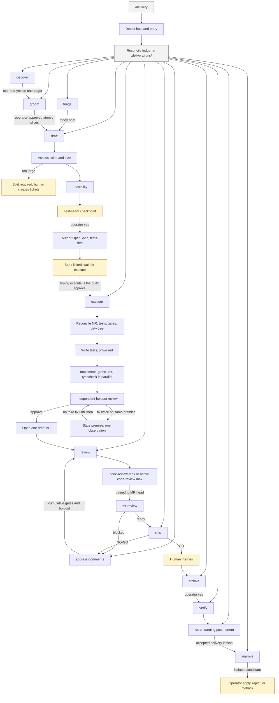

# Delivery skills

One SDLC conductor for **Cursor** and **Claude Code**. Clone this repository,
install once per host, and run `/delivery`.

The pack includes:

- `/delivery` — thin conductor, ledger, auto, retro, approval-gated improvement
- `/groom` `/draft` `/execute` `/address-comments` — portable factory (vendored from ig-spec, no Claude plugin required)
- `/code-review-max` `/mr-review` — dual-pass GitLab review
- `/openspec-archive` — post-merge OpenSpec archive

## Install

```bash
git clone https://gitlab.com/Sheikh.Ahmed1/delivery-skills.git
cd delivery-skills
./install.sh                 # Cursor + Claude Code
# ./install.sh --all         # also copies the Cloud Agent store when writable
# ./install.sh --cursor
# ./install.sh --claude
# ./install.sh --store       # Cursor Cloud Agent skill store
```

`--all` installs Cursor and Claude Code, then copies the Cloud Agent store if
that path is writable. On a Mac it skips `/cursor` instead of failing after
the desktop hosts are already linked.

What the installer does:

- Runs `bun install --frozen-lockfile` in `factory/`, so every machine uses the
  same pinned dependencies.
- Links each skill into `~/.cursor/skills` and `~/.claude/skills`, replacing
  stale copied directories with symlinks.
- Installs `gl-mr` and `gl-note` into `${DELIVERY_BIN_DIR:-~/.local/bin}`.
  Make sure that directory is on `PATH`.
- For the Cloud Agent store, copies the factory to `skills/_factory/` so it syncs
  with the skills, without `node_modules` or review scratch files.

Open a **new** chat on each host so the skills reload.

### GitLab access

`gl-mr` and `gl-note` read `GITLAB_TOKEN` first, then the file named by
`GL_TOKEN_FILE` (default `~/token`). The token is passed to curl through a
private temporary config file, never on the command line. The GitLab host and
project come from the `origin` remote, including credentialed HTTPS remotes.

In a Cloud Agent, add `GITLAB_TOKEN` as a secret and run
`bash skills/mr-review/cloud-setup.sh` once if the wrappers are not on `PATH`.

### Claude Code guard hook

Merge `adapters/claude-code/settings.json` into your Claude Code settings and
set `DELIVERY_FACTORY_ROOT` to this clone's `factory/` directory. The hook blocks
AI attribution, `glab mr merge`, `glab mr close`, force pushes, hard resets, and
Jira mutations. Cursor has no equivalent hook, so the skills state the same
rules as explicit allowlists.

## Use

In the target repository:

```text
/delivery auto
/delivery help
```

`/delivery` invokes `/groom`, `/draft`, `/execute`, `/address-comments`,
`/code-review-max` or native `/code-review max`, `/mr-review`, and
`/openspec-archive`. It does not call `/ig-spec:*`.

## SDLC

`/delivery` is the only command to remember. It routes into the stage skills
below, records state in the target repository's `.delivery/runs/`, and stops for
operator-owned decisions. Humans own merge, archive, Jira status, and any
live-skill install.



Human-owned stops, in order:

1. Groom slice approval, then draft test-seam approval.
2. Typing `/delivery execute` is the approval to build.
3. Merge, then archive.
4. Installing or rolling back a delivery-skill candidate.

## Guarantees

Every gate fails closed. A malformed verdict, a missing artifact, or an
ambiguous match stops the run instead of guessing.

- **Tickets are atomic.** Each ticket is one vertical outcome with one to three
  Given/When/Then acceptance criteria, small enough for one fresh session.
  Oversized tickets stop at draft with a proposed split.
- **Tests come first.** The red gate runs a JSON argv command (never a shell
  string), requires exit code 1, and requires the output to name every new test
  file. A missing command, a timeout, or zero tests is not a red result.
- **Approval needs every dimension.** The holdout review approves only when the
  change is faithful to the spec, the tests are meaningful, the code matches the
  spec, and it is ready for main.
- **Execute opens a draft MR.** It is marked ready only after both review
  passes. Release readiness refuses a draft MR or a missing review verdict; an
  operator cannot stand in for a review.
- **Comments are handled once.** Every in-scope comment must be classified,
  with no missing, extra, or duplicate ids. Only replies from the factory's own
  account mark a thread handled, and a human follow-up brings it back into scope.
  If a run stops after replying, the next run still performs the holdout review.
- **Published notes are jailed.** `gl-note` posts only files under the target
  repository's `.review/` directory and refuses symlink escapes and secret-like
  filenames.
- **Run state is shared safely.** Ledgers use a generation number and refuse a
  stale write instead of overwriting another session's update.
- **Waiting never polls.** A running pipeline or deploy ends the turn with the
  command to resume.
- **Model routing is shadow-only.** A frontier-level read-only controller
  writes each task profile. The host's advertised model identifiers are
  recorded, and the catalogue resolves each required capability to an
  available model. Muse Wonder is a frontier candidate. Stages record the
  cheaper recommended tier, gate
  outcomes, repairs, escalations, and token or character counts under
  `.delivery/routing/`, then emit a comparison report. They still dispatch
  today's Sonnet/Opus selection. Fast models stay off until scored reversible
  work clears the 90 percent bar. Safety floors keep auth, migrations,
  concurrency, holdout review, and irreversible work on the frontier
  recommendation.
- **Retro teaches the engineering journey.** It writes a chronological
  postmortem covering the problem, attempted models, counterexamples, design
  evolution, final invariants, DSA complexity, and system-design trade-offs. It
  does not invent algorithmic depth when the change had none.

## Artifacts

All live state belongs to the target repository and is gitignored:

| Path | Holds |
|------|-------|
| `.delivery/runs/` | Run ledgers, discovery evidence, and engineering postmortems |
| `.delivery/routing/` | Task profiles, shadow decisions, outcomes, comparison report, evaluation corpus |
| `.delivery/candidates/`, `.delivery/versions/` | Improvement candidates and rollback copies |
| `.review/<change>/` | Gate commands, append-only gate results, diffs, verdicts |
| `.review/mr-<iid>/<head-sha>/` | Review brief, max-pass findings, and draft notes |

Review artifacts are keyed by the MR head, so `/mr-review` can run in a fresh
chat after `/code-review-max`. A new head always needs a new max pass.

## Layout

```text
skills/           # what both hosts load
factory/          # gate scripts and subagent prompts
adapters/         # host notes and the Claude Code guard hook
```

Self-improvement (`/delivery improve`) edits `skills/delivery` only, after
approval. Factory changes are ordinary commits in this repository.

## Tests

```bash
cd factory
bun install --frozen-lockfile
bun run check
bun test
cd ..
BUN_RUNTIME_TRANSPILER_CACHE_PATH=0 bun test skills/delivery/checks/delivery-specs.test.ts
```
