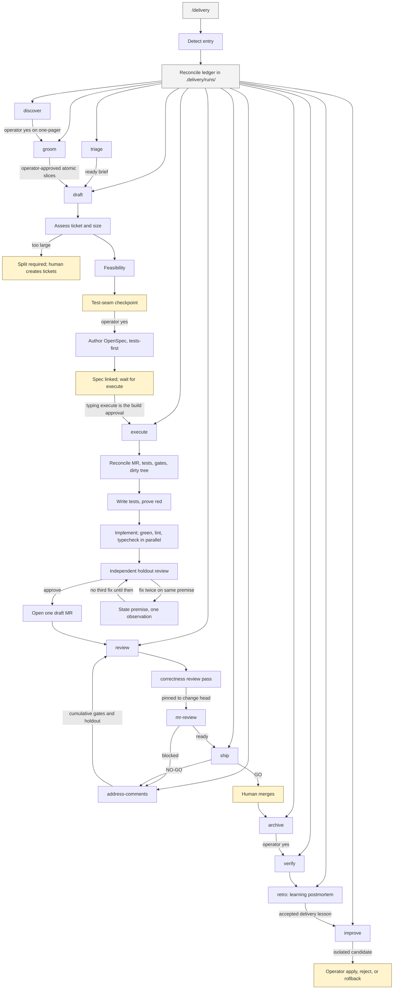

# Delivery skills

A portable SDLC conductor for any LLM or agent host that can load skills and
satisfy the declared runtime capabilities. Clone this repository, install into
an explicit skills directory, and run `/delivery`.

This pack does not run in a text-only chat. Deterministic gates need subprocess
execution. Mutating stages need an enforceable mutation boundary. Forge,
tracker, and review publication run only when those providers are present.

The pack includes:

- `/delivery` — thin conductor, ledger, auto, retro, approval-gated improvement
- `/groom` `/draft` `/execute` `/address-comments` — portable factory stages
- `/code-review-max` `/mr-review` — dual-pass change review
- `/openspec-archive` — post-merge archive

## Install

```bash
git clone https://gitlab.com/Sheikh.Ahmed1/delivery-skills.git
cd delivery-skills
./install.sh --skills-dir /path/to/skills
# ./install.sh --skills-dir /path/to/skills --adapter <name>
```

`--skills-dir` is required. The installer never infers a host. Optional
`--adapter <name>` applies setup from `adapters/<name>/` after the generic pack
is in place. Named-host wrappers live with those adapters, not in the generic
interface.

What the installer does:

- Runs `bun install --frozen-lockfile` in `factory/`, so every machine uses the
  same pinned dependencies.
- Copies each skill and the runtime into the destination, writing a managed
  manifest. Reinstalls replace only managed files.
- Installs the generic runtime beside the skills at `_factory/`, without
  `node_modules` or review scratch files.
- Leaves unmanaged files and delivery state (`runs`, `candidates`, `versions`)
  untouched.
- Fails without replacing an existing install when the destination cannot be
  written.

Reload the host session so the installed skills are picked up.

### Capability prerequisites

A host can run this pack when it can:

- Load skills from the installed directory.
- Read and write the target repository, including `.delivery/` and `.review/`.
- Run subprocesses for deterministic gates (tests, verdicts, ledgers).
- Enforce a mutation boundary before any mutating stage. Without that, read-only
  stages still run and mutating stages stop closed.
- Provide forge, tracker, or review-publish capabilities when a stage needs
  them. Missing providers stop at that boundary and keep completed artifacts.

Portability means any host that satisfies those capabilities. It does not mean
the pack invents tools a host does not expose.

## Use

In the target repository:

```text
/delivery auto
/delivery help
```

`/delivery` invokes the stage skills through delivery descriptors. Slash names
are packaging sugar for hosts that load skills that way.

## SDLC

`/delivery` is the only command to remember. It routes into the stage skills
below, records state in the target repository's `.delivery/runs/`, and stops for
operator-owned decisions. Humans own merge, archive, tracker status, and any
live-skill install.



Human-owned stops, in order:

1. Groom slice approval, then draft test-seam approval.
2. Typing `/delivery execute` is the approval to build.
3. Merge, then archive.
4. Installing or rolling back a delivery-skill candidate.

## Guarantees

Every gate fails closed. A malformed verdict, a missing artifact, or an
ambiguous match stops the run instead of guessing.

- **Tickets are atomic.** Each ticket is one vertical outcome with one to three
  Given/When/Then acceptance criteria, small enough for one fresh session.
  Oversized tickets stop at draft with a proposed split.
- **Tests come first.** The red gate runs a JSON argv command (never a shell
  string), requires exit code 1, and requires the output to name every new test
  file. A missing command, a timeout, or zero tests is not a red result.
- **Approval needs every dimension.** The holdout review approves only when the
  change is faithful to the spec, the tests are meaningful, the code matches the
  spec, and it is ready for main.
- **Execute opens a draft change request.** It is marked ready only after both
  review passes. Release readiness refuses a draft change or a missing review
  verdict; an operator cannot stand in for a review.
- **Comments are handled once.** Every in-scope comment must be classified,
  with no missing, extra, or duplicate ids. Only replies from the factory's own
  account mark a thread handled, and a human follow-up brings it back into scope.
  If a run stops after replying, the next run still performs the holdout review.
- **Published notes are jailed.** The review publisher posts only files under
  the target repository's `.review/` directory and refuses symlink escapes and
  secret-like filenames.
- **Run state is shared safely.** Ledgers use a generation number and refuse a
  stale write instead of overwriting another session's update.
- **Waiting never polls.** A running pipeline or deploy ends the turn with the
  command to resume.
- **Model routing reads the runtime, then the catalogue.** Each run records the
  exact model identifiers the current runtime advertises into
  `.delivery/routing/model-inventory.json`. The workflow still names the
  required capability (standard or frontier). The catalogue then picks an
  exact advertised identifier for that capability. A cheaper shadow
  recommendation is recorded, never dispatched. Fast catalogue models stay
  evaluation-only until representative-run scores for that exact candidate
  clear the 90 percent bar with at least five reversible cases and no critical
  misses. Live evidence is not mixed into that sample. Safety floors keep auth,
  migration, concurrency, distributed-state, weak-verification, holdout review,
  and irreversible work on the frontier recommendation. Live availability stays
  unchanged without an exact operator promotion approval naming the candidate.
  Public rankings and unscored fixtures never promote.
- **Retro teaches the engineering journey.** It writes a chronological
  postmortem covering the problem, attempted models, counterexamples, design
  evolution, final invariants, DSA complexity, and system-design trade-offs. It
  does not invent algorithmic depth when the change had none.

## Artifacts

All live state belongs to the target repository and is gitignored:

| Path | Holds |
|------|-------|
| `.delivery/runs/` | Run ledgers, discovery evidence, and engineering postmortems |
| `.delivery/routing/` | Advertised model inventory, task profiles, shadow decisions, outcomes, comparison report, evaluation corpus |
| `.delivery/candidates/`, `.delivery/versions/` | Improvement candidates and rollback copies |
| `.review/<change>/` | Gate commands, append-only gate results, diffs, verdicts |
| `.review/<change-id>/<head-sha>/` | Review brief, max-pass findings, and draft notes |

Review artifacts are keyed by the reviewed head, so `/mr-review` can run in a
fresh session after `/code-review-max`. A new head always needs a new max pass.

## Layout

```text
skills/                    # generic skills any capable host can load
factory/                   # gate scripts and subagent prompts
factory/model-catalogue.json  # capability tiers to exact advertised models
adapters/                  # optional host, forge, and tracker adapters
```

Self-improvement (`/delivery improve`) edits `skills/delivery` only, after
approval. Factory changes are ordinary commits in this repository.

## Tests

```bash
cd factory
bun install --frozen-lockfile
bun run check
bun test
cd ..
BUN_RUNTIME_TRANSPILER_CACHE_PATH=0 bun test skills/delivery/checks/delivery-specs.test.ts
```
