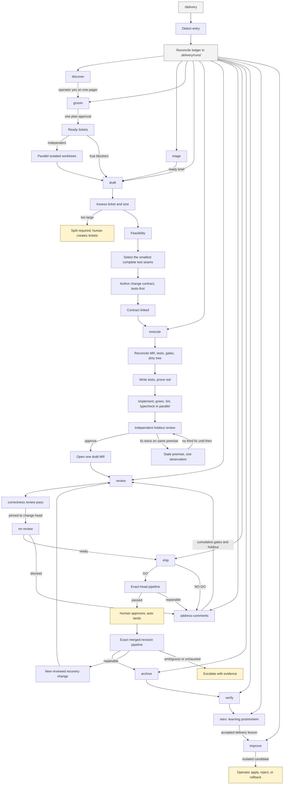

# Delivery

A portable software-delivery skill pack for any LLM or agent runtime that can
load skills and satisfy a small capability contract. The workflow and safety
rules are runtime-independent; native commands, hooks, models, forges,
work-item systems, and spec tools are optional adapters or providers.

This pack does not run in a text-only chat. Deterministic gates need subprocess
execution. Mutating stages need an enforceable mutation boundary. Forge,
remote work-item, and review publication run only when those providers are
present.

The pack includes:

- `/delivery` — thin conductor, ledger, auto, retro, approval-gated improvement
- `/groom` `/draft` `/execute` `/address-comments` — portable factory stages
- `/code-review-max` `/mr-review` — dual-pass change review
- exact-revision pipeline monitoring before and after merge
- a bundled OpenSpec archive stage, which requires the OpenSpec CLI

## Install

```bash
git clone https://gitlab.com/Sheikh.Ahmed1/delivery-skills.git
cd delivery-skills
./install.sh --skills-dir .agents/skills
# ./install.sh --skills-dir /path/to/skills --adapter <name>
# ./install.sh --skills-dir /path/to/skills --provider <name>
```

`--skills-dir` is required. The installer never infers a host. Optional
`--adapter <name>` applies setup from `adapters/<name>/` after the generic pack
is in place. Optional `--provider <name>` selects a forge, remote work-item, or
spec-tool provider from `providers/<name>/`. Generic install includes none unless
selected. Named-host wrappers live with those adapters, not in the generic
interface.

What the installer does:

- Checks the pinned Bun version from `factory/package.json` and prints the
  exact install command when Bun is missing or unmatched.
- Runs `bun install --frozen-lockfile` in `factory/`, so every machine uses the
  same pinned dependencies.
- Copies each skill and the runtime into the destination, writing a managed
  manifest. Reinstalls replace only managed files.
- Installs the generic runtime beside the skills at `_factory/`, including its
  pinned runtime dependencies but excluding review scratch files.
- Writes `_factory/runtime-manifest.json`. The generic baseline advertises
  subprocess execution and keeps every unavailable capability fail closed;
  selected adapters and providers overlay only capabilities they can verify.
- Leaves unmanaged files and delivery state (`runs`, `candidates`, `versions`)
  untouched.
- Restores the previous install if validation or selected setup fails.

Reload the host session so the installed skills are picked up.

Host adapters, provider catalogs, workflow, examples, troubleshooting, and
reference live under [`docs/README.md`](docs/README.md),
[`adapters/`](adapters/README.md), and [`providers/`](providers/README.md).

## Quick start

1. Install Bun `1.4.2` and the pack into a skills directory your runtime
   loads. Prefer a named adapter wrapper when one exists; see
   [`adapters/`](adapters/README.md). Put
   `${DELIVERY_BIN_DIR:-$HOME/.local/bin}` on `PATH`.
2. Reload the host, enter the repository to deliver, and run:

   ```bash
   export FACTORY_ROOT="/path/to/skills/_factory"
   bun "$FACTORY_ROOT/scripts/doctor.ts"
   bun "$FACTORY_ROOT/scripts/work-item-config.ts" options \
     "$FACTORY_ROOT/runtime-manifest.json"
   bun "$FACTORY_ROOT/scripts/delivery-init.ts" --work-items local-files
   ```

   `doctor` separates what is ready, what needs setup, host limitations, and
   actions that always remain human-owned. It reports credential presence only;
   it never prints credential values. It distinguishes read-only lifecycle
   from full lifecycle: an unpinned Bun version is a setup item, and mutating
   stages need a verified denial hook. Confirm one listed work-item provider;
   local files are always available, while Jira, forge issues, and custom
   providers appear only when the runtime substantiates them. The choice is
   stored in `.delivery/work-items.json` and is never inferred from remotes or
   credentials. `delivery-init.ts` idempotently adds `.delivery/` and `.review/`
   to the target repository's `.gitignore`, then reprints only unresolved
   doctor checks.
3. Invoke the `delivery` skill with `help`, `doctor`, `init`, or `status`. If the
   runtime exposes slash skills, use `/delivery help`, `/delivery doctor`,
   `/delivery init`, or `/delivery status`.

Read-only stages can run with a smaller capability set. Mutating stages require
`mutation.guard` with `enforcement: "enforced"`. A missing capability produces a
configuration remedy instead of a guessed fallback.

### Capability prerequisites

A host can run this pack when it can:

- Load skills from the installed directory.
- Read and write the target repository, including `.delivery/` and `.review/`.
- Run subprocesses for deterministic gates (tests, verdicts, ledgers).
- Enforce a mutation boundary before any mutating stage. Without that, read-only
  stages still run and mutating stages stop closed.
- Dispatch isolated mutating agents with an explicit working directory and
  environment. This is required to run independent tickets concurrently.
- Confirm a repository work-item provider. Local files need no service.
  Continuous groom needs create and link support from a selected remote
  provider after plan approval. Missing providers stop at that boundary and
  keep completed artifacts.
- Run forge change and review operations through
  `scripts/forge-provider.ts`. When the host exposes matching session tools
  (MCP or equivalent), delivery plans those tools first and validates their
  output through the same operations. Generic skills never call a
  provider-native helper.

Portability means any host that satisfies those capabilities. It does not mean
the pack invents tools a host does not expose.

### Forge command

Every generic workflow reads and publishes forge state with one command:

```
bun "$FACTORY_ROOT/scripts/forge-provider.ts" <operation> <repoRoot> \
  "$FACTORY_ROOT/runtime-manifest.json" [input.json]
```

Operations: `find`, `read`, `pipeline`, `files`, `diff`, `commits`, `discussions`,
`anchors`, `approvals`, `create`, `set-draft`, `note`, `reply`, `land`. Review evidence is fetched
one view at a time in the order the review skill names. Notes are dry-run,
shown, then posted one at a time after human confirmation (or standing
continuous-delivery authorization). Close and thread resolution stay
human-owned. Merge does too, except that `/delivery auto` lands a change a
person approved on the forge once its pipeline is green, through the gated
`land` operation. Provider-native helpers are not generic workflow commands.

If the current session exposes matching integration tools, `/delivery doctor`
records them and later stages prefer those tools over CLI adapters. The result
is still schema-validated. A host tool that merges, closes, approves, deletes,
or changes work-item status is never used.

## Use

In the target repository:

```text
/delivery <idea, PRD path, or epic key>
/delivery auto <existing run key>
/delivery help
```

`/delivery` invokes the stage skills through delivery descriptors. Slash names
are packaging sugar for hosts that load skills that way.

## Continuous delivery

Use `/delivery <idea-or-PRD>` for new work or `/delivery auto <key>` to resume
existing work. The skill decides simple, reversible, and discoverable work itself. It only
stops you for product intent or a hard-to-reverse trade-off. Those stops open
with the options and trade-offs first. After you pick, it shows its own
recommendation and why, and you can change your mind. It then presents the
final atomic ticket plan.
Your approval of that plan is the single routine delivery
authorization for the run.

After approval, it automatically:

1. Creates or reuses exactly the approved work items and dependency links
   through the repository's confirmed provider.
2. Finds every ticket whose real blockers are already merged.
3. Starts independent tickets concurrently, one isolated git worktree and
   worker per ticket, at most `maxParallelWorktrees` at a time (default 4,
   override with `MAX_PARALLEL_WORKTREES`). True blockers remain ordered.
4. Drafts the change contract, selects test seams, builds test-first, runs all
   gates, performs both review passes, publishes review notes, and monitors the
   merge request pipeline at its exact head revision.
5. After you merge, monitors the default-branch pipeline at the exact merged
   revision before archiving the change, verifying the deployment, writing the
   engineering retro, and preparing any evidence-backed delivery-skill
   improvement candidate.

It does not ask whether to proceed between those stages. It stops only when:

- a product decision is still needed before the final plan;
- a failed gate cannot be repaired safely inside the approved contract and
  bounded attempt budget, or evidence is missing or contradictory;
- a release requires explicit risk acceptance;
- a change is waiting for a person to approve it on the forge (auto then
  lands it once its pipeline is green);
- an evaluated skill candidate is ready for exact install or rollback approval.

Plan approval authorizes landing a change only through the land gate: a person
approved it on the forge, its pipeline passed, and readiness gave GO, all at
the same commit. It never authorizes any other merge, closing work items,
release-risk acceptance, bypassing a gate, or installing a skill candidate.

### Pipeline monitoring and recovery

Delivery treats the merge request head and the merged default-branch commit as
separate integration points. A green merge request does not prove that the
commit created by the merge is green. Evidence must name the exact revision
being evaluated.

While a pipeline is queued or running, delivery subscribes to host events when
available and ends the turn. It never sleeps or repeatedly polls. Without an
event subscription, it leaves `/delivery auto <KEY>` as the resume command.

When a pipeline fails, delivery uses job evidence and, where possible, a local
reproduction to classify the failure:

- An attributable, in-scope failure below the run's `maxFixAttempts` budget may
  fix forward. Before merge it repairs the existing change and reruns every
  invalidated gate. After merge it opens a new reviewed recovery change; it
  never pushes directly to the default branch.
- A transient, unrelated, ambiguous, out-of-scope, or budget-exhausted failure
  escalates with the revision, failed checks, sanitized evidence, and suggested
  human action.

Provider job retries, rollback, an ungated merge, close, revert, and
protected-branch writes remain human-owned.

That same approval freezes a hashed run contract at
`.delivery/runs/<id>.run-contract.json`. Later stages check the hash. A ticket,
goal, or write outside that contract is a terminal stop until the operator
approves a new plan version.

Parallel workers never race to edit the shared run ledger. Each writes a
key-specific journal; the coordinator validates those journals against git and
the forge, then records the completed wave in one compare-and-swap update. If
the runtime cannot provide isolated mutating workers, delivery stops with
runnable fan-out commands rather than silently processing independent tickets
sequentially.

## Constitution and run contracts

[`skills/delivery/SDLC-CONSTITUTION.md`](skills/delivery/SDLC-CONSTITUTION.md)
is the short policy kernel for the whole lifecycle. Its machine-readable
companion,
[`sdlc-constitution.json`](skills/delivery/sdlc-constitution.json), maps each
commandment to a schema, gate, state-machine transition, contract test, or
explicit judgement boundary. Every stage loads the same version.

The constitution has highest precedence. The remaining order is the delivery
conductor, auto workflow, ledger contract, current stage spec, and stage skill.
Historical workflow notes are non-actionable. A lower-precedence instruction
cannot enlarge approved scope, claim a human-owned action, or override a
failed deterministic gate.

The kernel requires delivery to:

- stay inside approved scope and prefer the smallest complete vertical change;
- avoid speculative abstractions and adjacent cleanup;
- discover facts before asking for genuine product decisions;
- keep acceptance criteria and tests independent of implementation;
- run every mutation through an enforceable, attributable boundary;
- fail closed on missing, malformed, stale, or ambiguous evidence;
- run independent work concurrently and order only real dependencies;
- preserve security, validation, accessibility, recovery, and data protection;
- resume from durable artifacts rather than conversational memory; and
- record deviations with the affected invariant and a new approval.

Humans own approving each change and every merge outside the land gate in
`/delivery auto`, tracker close (closing, reopening, deleting, or moving a
ticket backwards), release-risk acceptance, failed-gate override,
and every live-skill install or rollback. Tickets move forward on the board
as delivery progresses, but only to the columns of a board map the operator
confirmed during `/delivery init`.

### Frozen scope

When the final groomed plan is approved, delivery writes
`.delivery/runs/<id>.run-contract.json`. It hashes the constitution plus the
approved goal, scope, non-goals, tickets, dependency graph, acceptance
criteria, permitted writes, approval evidence, and human-owned boundaries.
Draft, execute, review, and later stages verify that hash before acting.

A constitution mismatch, changed contract body, unknown ticket, or unapproved
write stops the run. To change scope, create a new plan version that names the
previous contract hash, explains the reason and affected invariant, and records
a new explicit approval. The previous contract remains durable evidence.

Runtime and CI checks use one command:

```bash
bun "$FACTORY_ROOT/scripts/doctor.ts"
```

The compatibility preflight command delegates to the same doctor. For the
constitution-only runtime and CI check, use:

```bash
bun "$FACTORY_ROOT/scripts/sdlc-constitution.ts" preflight
```

The constitution helper also exposes `freeze`, `check`, and `report` for
run-contract creation, stage-boundary validation, and conformance evidence.
See the constitution itself for the canonical commandments; the README
deliberately does not maintain a second numbered rule catalogue.

## SDLC

`/delivery` is the only command to remember. It routes into the stage skills
below, records state in the target repository's `.delivery/runs/`, and stops for
operator-owned decisions. Approval of the final groomed plan authorizes routine
progression through delivery, including landing changes a person approved.
Humans still own approval, any other merge, closing work items, explicit risk
acceptance, and any live-skill install.



Human-owned stops, in order:

1. Product decisions while shaping the work, then one final groomed-plan
   approval.
2. Approving each change on the forge (auto lands it once green), or explicit
   acceptance of a release risk.
3. Installing or rolling back an exact delivery-skill candidate.

## Learning while the factory runs

The factory is meant to make the operator a stronger engineer, even when they
are not writing the code.

- **The factory takes simple decisions.** Facts, one viable path, and cheap
  reversible defaults are decided, logged as agent-owned, and not asked.
- **Escalate only what you must own.** Product intent, irreversible trade-offs,
  approving a change, release risk, and skill install stop for you. Everything else
  continues.
- **When it does stop, decide before you see a preferred answer.** The brief
  opens with evidence, options, and trade-offs. The recommendation comes after
  you pick, with a chance to switch.
- **Ground every trade-off in this codebase.** An escalated question names the
  module, file, or domain term the choice will touch.
- **Keep a decision log.** Grooming writes `decisions.md` for both agent-owned
  decisions and your picks. The closing summary recaps it. Retro reads it when
  it reconstructs the engineering story.
- **Look back as a case study.** After merge, retro writes an engineering
  postmortem: the problem, the attempts, what disproved them, and the data
  structure and system-design lessons.

A failed gate is never dressed up as an option.

## Cost controls

Default delivery keeps the expensive model for work that can change the
outcome: implementation when complexity is recorded as high, first holdout
review of new code, and holdout review after a comment round that changes the
commit. Independent tests, security-sensitive feasibility, and dual review
before readiness still run. A bounded rename, import-only, or format-only
unit is classified by `mechanical-edit.ts` before any extra worker.
`apply-mechanical-edit.ts` applies it without a model when it can prove the
rewrite for TypeScript, JavaScript, Python, Java, Go, or C#:

- rename: a TypeScript or JavaScript identifier, a Python function, class,
  parameter, or local, a single Java type, method, or field, or one unexported
  Go identifier or C# declaration, when every reference is in the listed
  files. A unique Java type also renames `From.java` to `To.java` when the
  listed file name matches
- import-only: unused TypeScript or JavaScript imports, a unique missing
  TypeScript, Python, or Java import, unused Python top-level names, unused
  Java single-type imports, unused Go imports, a unique local Go package
  import, or a unique repository C# type import, when the rest of the file is
  unchanged
- format-only: spacing that leaves names and literals identical, using a
  repo Prettier, Ruff, google-java-format, or `bin/csharpier` binary when one
  is present, and Go standard formatting

Anything the helper cannot prove — overloads, incomplete file lists, mixed
languages, star imports, a Python attribute or `exec`/`eval` of the same
name, `serialVersionUID`, extract method, or a repo formatter that changes
names or literals — keeps today's worker. Those units sit in
`mechanical-edit-scoring.ts`. `mechanical-edit-test-repos.ts` materializes
them as temporary git repositories and runs a paired baseline/candidate
loop. A local listed-file rewrite is recorded as `test-repo-stand-in` and
does not count toward graduation. Real scores come from
`mechanical-edit-model-runs.ts`: prepare the capture directory, dispatch
the live standard worker and the named fast catalogue model with
`model-catalogue.ts resolve fast <inventory> --evaluation`, drop the trees
and `capture-usage.ts` token files, then ingest naming that exact fast id.
Ingest refuses a non-fast model, character-only usage, and the stand-in
rewrite. The host must accept the exact candidate id as a dispatchable
model before the candidate arm. Inventory membership and evaluation
resolve are not a run. A refused host id produces no ingest JSON and
does not promote. A new exact id joins the fast tier with
`model-catalogue.ts register-fast <id>`. It stays evaluation-only until
`fast-dispatch.ts promote <corpus> <id> --approve <id>` writes it live
after an exact operator promotion approval. `muse-spark-1.3-medium` and
`haiku` are live after that path. Live resolve may return an advertised
alias the host accepts (`claude-haiku-5-5-medium` for Haiku). Composer stays evaluation-only. Scores do not carry to a
later version id. The worker never decides that its own job is menial.

A model does not start when a script can already prove the outcome:

- `/execute` skips the test-writer, red gate, and implementer on a proven
  rename, unused or unique missing import, or format-only unit, including a
  unique Python parameter or local, a unique Java field, a Java type
  whose listed file name matches, and a unique TypeScript, Python, Java, Go, or C#
  missing import. Green, lint, typecheck, and holdout still
  run
- `/groom` skips the explorer, grilling, and writer when the input already
  verifies as a ticket, including a fill of missing Out of scope and Blocked
  by as `None.`
- `/draft` skips the ticket assessor and feasibility analyst on a complete
  ordinary ticket, on recorded blockers, on a size warning, and when What to
  build or Acceptance criteria name authentication, authorization, secrets,
  credentials, OAuth, OIDC, JWT, or a data, schema, or database migration.
  After the specs exist, `generate-tasks.ts` writes `tasks.md` from the
  scenarios so a model does not invent the task list
- `/address-comments` skips the comment assessor on resolved, empty,
  acknowledgement-only, mention-only, URL-only, and emoji-only notes, and on
  a suggestion already present in the file. A whole-body suggestion fence,
  including a `:-N+M` range, is applied without the implementer
- `/code-review-max` starts no review lenses when the measured diff has no
  reviewable code. `/delivery` release readiness does the same for empty and
  proven small diffs; a small code change still runs rollback in the main
  conversation

Holdout still runs on new or changed code. Composer stays evaluation-only.

Each of those skips is recorded by `record-skip.ts` even when diagnostic
profiling is off. The run scorecard prints how many workers were avoided
and never estimates tokens saved.

Diagnostic shadow profiling defaults off so a ticket does not pay extra
frontier calls that cannot affect live dispatch. Set
`ROUTING_PROFILING=always` only when collecting evaluation evidence. Live
model selection and quality gates stay the same in both modes.

The correctness review pins the advertised model list, resolves the standard
tier, then asks `review-fanout.ts` which lenses to start. A small reversible
change is at most 2 files, fewer than 50 changed lines, a two-way door, and
none of Data, Contract, Config, Auth, or Infra. That case runs correctness and
security plus tests and specification. So does a contained change: reversible,
at most 6 files and fewer than 400 lines, with no sensitive surface or
dependency change. Larger, one-way, sensitive, or uncertain changes retain all
four lenses. Invalid input fails closed rather than guessing a cheaper pass.
Counts leave out the change's own OpenSpec and delivery files. When no lens
raises a candidate there is nothing to verify; when every candidate is Low,
one standard-tier subagent verifies them; a Medium or higher candidate is
verified by the main conversation.

A subagent re-reads its whole conversation on every step, so each file it
opens separately costs again on every later step. `review-packet.ts` bundles
what a role needs into one file. The test writer gets the work item and spec;
the implementer adds the diff so far and the gate result it answers; the
holdout reviewer adds the complete diff and gate evidence; the adjudicator adds
every lens's candidates. Review lenses keep the plain brief and diff, because
they read the code they check anyway.

When the implementer reports that a failing test contradicts the approved spec,
execute sends that one test back to the test writer instead of spending another
implementer fix on it. The test writer re-derives the value from the spec and
changes nothing if the test was right. The holdout review still checks every
test.

See [workflow](docs/workflow.md) and [reference](docs/reference.md) for the
operator knobs.

## Guarantees

Every gate fails closed. A malformed verdict, a missing artifact, or an
ambiguous match stops the run instead of guessing.

- **Tickets are atomic.** Each ticket is one vertical outcome with one to three
  Given/When/Then acceptance criteria, small enough for one fresh session.
  Oversized tickets stop at draft with a proposed split.
- **Independent tickets run concurrently.** Auto reserves each ready batch of
  at most `maxParallelWorktrees` tickets (default 4), starts one isolated
  worktree worker per ticket, and lets the coordinator serialize validated
  journal results into the shared ledger. It never silently falls back to
  sequential execution.
- **Tests come first.** The red gate runs a JSON argv command (never a shell
  string), requires exit code 1, and requires the output to name every new test
  file. A missing command, a timeout, or zero tests is not a red result.
- **Approval needs every dimension.** The holdout review approves only when the
  change is faithful to the spec, the tests are meaningful, the code matches the
  spec, and it is ready for main.
- **Execute opens a draft change request.** It is marked ready only after both
  review passes. Release readiness refuses a draft change or a missing review
  verdict; an operator cannot stand in for a review.
- **Comments are handled once.** Every in-scope comment must be classified,
  with no missing, extra, or duplicate ids. Only replies from the factory's own
  account mark a thread handled, and a human follow-up brings it back into scope.
  A round that changes the commit still runs holdout review. A reply-only round
  whose commit is unchanged stays draft and continues to dual review instead of
  repeating holdout on the same code.
- **Published notes are jailed.** The review publisher posts only files under
  the target repository's `.review/` directory and refuses symlink escapes and
  secret-like filenames.
- **Run state is shared safely.** Ledgers use a generation number and refuse a
  stale write instead of overwriting another session's update.
- **Waiting never polls.** A running pipeline uses a host event subscription
  when available, then ends the turn. Delivery watches both the open-change
  head and the exact merged revision on the default branch. Attributable,
  in-scope failures fix forward within a bounded budget; the rest escalate.
- **Model routing reads the runtime, then the catalogue.** Each run records the
  exact model identifiers the current runtime advertises into
  `.delivery/routing/model-inventory.json`. The workflow still names the
  required capability (standard or frontier). The catalogue then picks an
  exact advertised identifier for that capability. Diagnostic shadow profiling
  defaults off. Set `ROUTING_PROFILING=always` to collect evaluation evidence;
  only then is a cheaper shadow recommendation recorded, never dispatched.
  Each recorded task captures wall time automatically, overlays host token and cost
  figures when the runtime writes them, and otherwise stores character
  counts of named artifacts. Scripted skipped workers are recorded even
  when profiling is off. After each task, the run scorecard refreshes with
  actual gate, repair, escalation, time, cost, and usage totals, plus the
  count of workers avoided. It never estimates tokens saved. It labels
  shadow quality and savings as unevaluated until a paired benchmark has
  actually run. The paired-evidence generator hashes fixed inputs and managed
  trees, reads captured usage and gate results, and measures output size
  instead of relying on hand-transcribed benchmark evidence. Fast catalogue
  models stay evaluation-only until representative-run scores for that exact
  candidate clear the 90 percent bar with at least five reversible cases and
  no critical misses, then `fast-dispatch.ts promote` with `--approve` of
  that same id. Spark and Haiku are live after that path. Composer stays
  evaluation-only. A later version id is a new candidate. Live evidence is
  not mixed into that sample. Safety floors keep auth,
  migration, concurrency, distributed-state, weak-verification, holdout
  review, and irreversible work on the frontier recommendation. Live
  availability stays unchanged without an exact operator promotion approval
  naming the candidate. Public rankings, unscored fixtures, and test-repo
  stand-in rewrites never promote.
- **Review spend follows demonstrated risk.** Independently adjudicated review
  lenses use the standard model tier. Release-readiness lens subagents use that
  same resolved standard model; `review-fanout.ts readiness` skips those
  subagents on an empty or proven small reversible measured diff. The main
  conversation still decides GO or NO-GO. `review-fanout.ts` chooses no lenses when the measured diff has no
  reviewable code, two essential
  lenses for a proven small reversible or contained change, and all four lenses
  otherwise.
  Reply-only comment rounds do not send an unchanged commit through duplicate
  gates and frontier holdout review. Any changed commit still does, and dual
  review remains mandatory before readiness.
- **Retro teaches the engineering journey.** It writes a chronological
  postmortem covering the problem, attempted models, counterexamples, design
  evolution, final invariants, DSA complexity, and system-design trade-offs. It
  does not invent algorithmic depth when the change had none.

## Artifacts

All live state belongs to the target repository and is gitignored:

| Path | Holds |
|------|-------|
| `.delivery/runs/` | Run ledgers, frozen run contracts, discovery evidence, and engineering postmortems |
| `.delivery/workers/<run>/<key>.md` | Isolated worker journals reconciled by the coordinator after a parallel wave |
| `.delivery/routing/` | Advertised model inventory, task profiles, shadow decisions, outcomes, usage capture, per-run scorecards, comparison report, evaluation corpus |
| `.delivery/candidates/`, `.delivery/versions/` | Improvement candidates, generated paired evidence, and rollback copies |
| `.review/<change>/` | Gate commands, append-only gate results, diffs, verdicts |
| `.review/<change-id>/<head-sha>/` | Review brief, max-pass findings, and draft notes |

Review artifacts are keyed by the reviewed head, so `/mr-review` can run in a
fresh session after `/code-review-max`. A new head always needs a new max pass.

## Layout

```text
docs/                      # operator guides (start at docs/README.md)
skills/                    # generic skills any capable host can load
skills/delivery/SDLC-CONSTITUTION.md  # policy kernel loaded by every stage
factory/                   # gate scripts and subagent prompts
factory/model-catalogue.json  # capability tiers to exact advertised models
adapters/                  # optional runtime integrations and compatibility
providers/                 # optional forge, work-item, review, and spec tools
```

Self-improvement (`/delivery improve`) edits `skills/delivery` only, after
approval. Factory changes are ordinary commits in this repository.

## Tests

See [`CONTRIBUTING.md`](CONTRIBUTING.md).

```bash
cd factory
bun install --frozen-lockfile
bun run check
bun test
cd ..
BUN_RUNTIME_TRANSPILER_CACHE_PATH=0 bun test skills/delivery/checks
```
