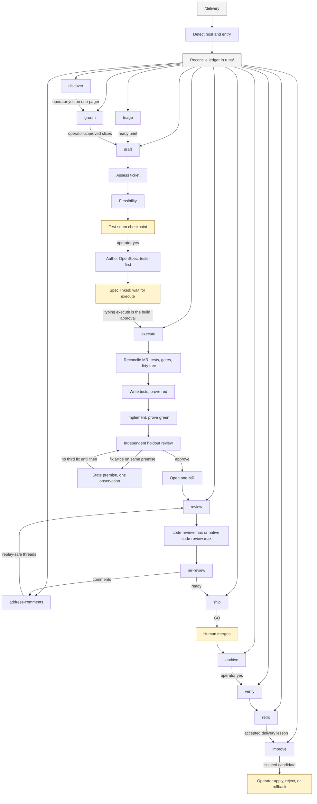

# Delivery skills

One SDLC conductor for **Cursor** and **Claude Code**. Clone this repository,
install once per host, and run `/delivery`.

The pack includes:

- `/delivery` — thin conductor, ledger, auto, retro, approval-gated improvement
- `/groom` `/draft` `/execute` `/address-comments` — portable factory (vendored from ig-spec, no Claude plugin required)
- `/code-review-max` `/mr-review` — dual-pass GitLab review
- `/openspec-archive` — post-merge OpenSpec archive

## Install

```bash
git clone https://gitlab.com/Sheikh.Ahmed1/delivery-skills.git
cd delivery-skills
./install.sh                 # Cursor + Claude Code
# ./install.sh --all         # also copies the Cloud Agent store when writable
# ./install.sh --cursor
# ./install.sh --claude
# ./install.sh --store       # Cursor Cloud Agent skill store
```

`--all` installs Cursor and Claude Code, then copies the Cloud Agent store if
that path is writable. On a Mac it skips `/cursor` instead of failing after
the desktop hosts are already linked.

Open a **new** chat on each host so the skills reload.

## Use

In the target repository:

```text
/delivery auto
/delivery help
```

`/delivery` invokes `/groom`, `/draft`, `/execute`, `/address-comments`,
`/code-review-max` or native `/code-review max`, `/mr-review`, and
`/openspec-archive`. It does not call `/ig-spec:*`.

## SDLC

`/delivery` is the only command to remember. It routes into the stage skills
below, records state in `runs/`, and stops for operator-owned decisions. Humans
own merge, archive, Jira status, and any live-skill install.



Human-owned stops, in order:

1. Groom slice approval, then draft test-seam approval.
2. Typing `/delivery execute` is the approval to build.
3. Merge, then archive.
4. Installing or rolling back a delivery-skill candidate.

## Layout

```text
skills/           # what both hosts load
factory/          # gate scripts and subagent prompts
adapters/         # host notes, not a second copy of the skills
```

Self-improvement (`/delivery improve`) edits `skills/delivery` only, after
approval. Factory changes are ordinary commits in this repository.

## Tests

```bash
bun install --cwd factory
bun test factory/scripts
BUN_RUNTIME_TRANSPILER_CACHE_PATH=0 bun test skills/delivery/checks/delivery-specs.test.ts
```
